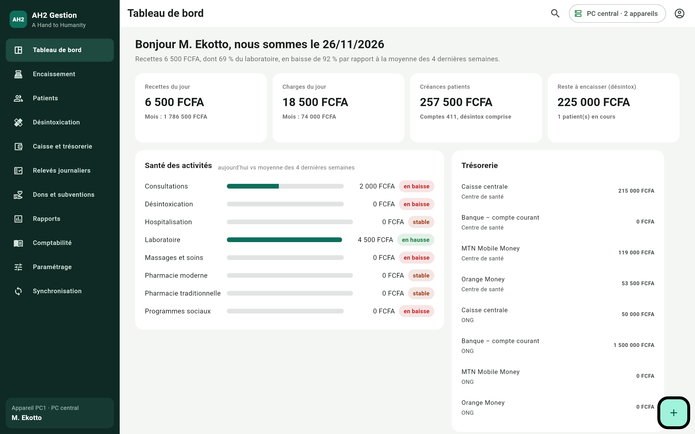

# AH2 Gestion

Logiciel de gestion intégrée de l'ONG **A Hand to Humanity (AH2)** et de son centre de santé.

Il tient en **une seule application** pour le PC (Windows) et le téléphone (Android). La version iPhone pourra être ajoutée sans réécriture. Il fonctionne **entièrement hors ligne** : aucun hébergement web, aucun lien Internet. Les appareils se synchronisent avec le PC central **uniquement par le Wi-Fi local** de la structure.



## État : phase 1 (§12 du cahier des charges)

| Domaine | État |
|---|---|
| Architecture hors ligne, base locale par appareil (chiffrée), synchronisation Wi-Fi chiffrée | ✅ |
| Interface moderne : barre latérale sur PC, barre en bas sur téléphone, bouton (+), recherche, modes clair et sombre, taille du texte réglable | ✅ |
| Paramétrage : 2 entités, plans comptables, journaux, activités, tarifs historisés, seuils, rôles et droits, appareils | ✅ |
| Patients (historique des versions, conflits signalés) | ✅ |
| Caisse et trésorerie : caisses centrale et mobiles, banque, mobile money, dépenses avec validation, mouvements internes, arrêté avec billetage | ✅ |
| Consultations, laboratoire, massages (actes, gratuités, remises, crédit, prise en charge) | ✅ |
| Désintoxication (§6.6 complet, dont l'archivage automatique et la réadmission) | ✅ |
| Relevés journaliers (§7) et fiches d'écart | ✅ |
| Dons et subventions (ONG) | ✅ |
| Moteur d'écritures, clôtures journalières, verrouillage des périodes | ✅ |
| Rapports journaliers, tableau de bord, alertes | ✅ |
| Sauvegardes chiffrées et restauration | ✅ |
| Pharmacies, hospitalisation, facturation complète, achats | Phase 2 |
| Paie, immobilisations, états SYCEBNL/SYSCOHADA, export Sage, prévisions | Phase 3 |

## Deux comptabilités

Le centre de santé et l'ONG sont deux entités distinctes :

| | Centre de santé (`CS`) | ONG AH2 (`ONG`) |
|---|---|---|
| Référentiel | SYSCOHADA révisé | SYCEBNL |
| Activités | Consultations, laboratoire, hospitalisation, désintoxication, massages, pharmacies | Programmes sociaux, dons, subventions |
| Pièces | `REC-CS-T01-2026-000451` | `DON-ONG-PC1-2026-000012` |

L'entité est choisie **automatiquement** selon l'activité : personne ne la choisit à la main. Les plans comptables sont livrés pré-remplis, avec la mention « à valider par le comptable ». Comptes, schémas d'écritures, tarifs, seuils et délais se modifient tous dans le paramétrage. **Rien n'est codé en dur.**

## Architecture

```
lib/
  noyau/        base SQLite, opérations immuables, audit chaîné, numérotation,
                sécurité (mots de passe), chiffrement, pièces jointes
  modules/      un module par domaine du §6 : parametrage, patients, tresorerie,
                actes, desintox, dons, cloture, releves, rapports, sauvegarde,
                comptabilite (moteur d'écritures)
  sync/         couche de synchronisation isolée (protocole + transport HTTP local)
  pdf/          documents : reçu 80 mm, relevé A4, rapport de sortie, rapport du jour,
                arrêté de caisse
  ui/           écrans Flutter (conformes aux maquettes validées)
  demo/         données de démonstration fictives
test/           tests automatisés des règles du §13
```

**Principe central : la saisie unique par opérations immuables.** Chaque action (encaissement, versement, dépense, don…) est une *opération* identifiée par un UUID. Enregistrer une opération se fait en **une seule transaction**, qui comprend :

1. la vérification des droits, de la date (journée non clôturée) et de l'état de l'appareil ;
2. l'attribution du numéro de pièce, sans trou ;
3. la génération de l'écriture comptable (contrôle débit = crédit), du mouvement de caisse et de la créance ;
4. la trace dans le journal d'audit.

La synchronisation recopie les **opérations**, jamais les résultats : chaque base les applique de la même façon. Il n'y a donc ni perte ni doublon. Une opération reçue n'est jamais rejetée : une incohérence devient une **anomalie** à traiter par le comptable.

Le schéma de la base est dans `lib/noyau/schema.dart`. Des déclencheurs SQL interdisent toute modification ou suppression des opérations, des écritures et du journal d'audit.

## Développement

```bash
flutter pub get
flutter test                      # règles du §13, synchronisation, chiffrement, écrans
flutter run -d windows            # PC
flutter build apk --release       # téléphone Android (APK installé directement)
flutter build windows --release   # puis installateur (voir docs/guide-installation.md)
```

Pour produire les captures d'écran des tests : `AH2_CAPTURES=1 flutter test test/ecrans --update-goldens`.

## Documentation

- [Guide d'installation](docs/guide-installation.md) : PC central, autres PC, téléphones, réseau Wi-Fi local, sauvegardes et restauration.
- [Guides utilisateurs par rôle](docs/guide-utilisateurs.md).
- [Points à valider par la structure](docs/points-a-valider.md).
